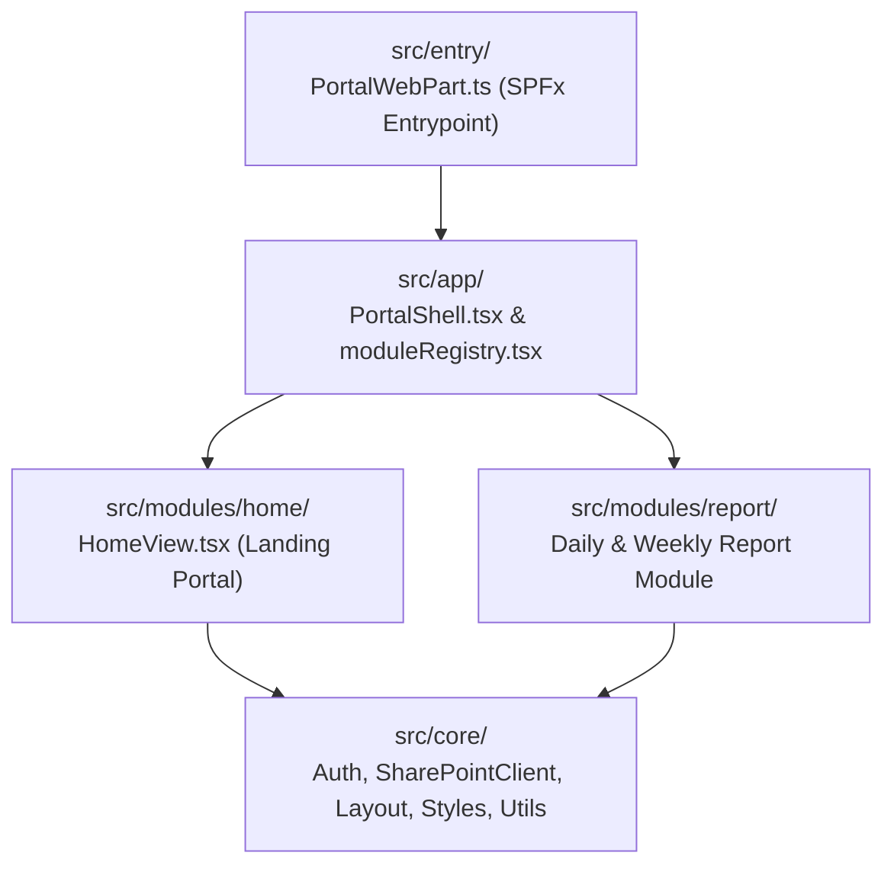

# Kiến Trúc Dự Án THADICO DQM - Workspace Portal (SPFx 1.24.1)

> **Mô hình kiến trúc:** Multi-Module Workspace Portal (Layered & Feature-Oriented React trên nền tảng SharePoint Framework `1.24.1`)
> **Mục tiêu:** Đảm bảo tính đóng gói độc lập giữa các module nghiệp vụ (hiện có `report`), dùng chung tầng hạ tầng cốt lõi (`core/`), miễn phí 100% bản quyền (không phụ thuộc Power Apps Premium), và dễ dàng mở rộng thêm module mới.

---

## 1. Sơ đồ phân tầng kiến trúc (Layered Architecture)



### Quy tắc phụ thuộc một chiều (One-Way Dependency Rule)
- `entry/` $\rightarrow$ `app/` $\rightarrow$ `modules/*` $\rightarrow$ `core/*`
- **Tầng `core/` KHÔNG BAO GIỜ import từ `modules/*`.**
- **Các module trong `modules/*` KHÔNG import chéo lẫn nhau.**
- Tầng `core/` và `app/` giữ tên trung lập, chỉ các file bên trong `src/modules/<name>/` mới mang tiền tố của module đó.

---

## 2. Cấu trúc thư mục chi tiết

```text
DQM_Check_In_App/
├── config/                              # Cấu hình SPFx build, serve & package-solution
├── sharepoint/solution/                 # Gói cài đặt thành phẩm (workspace_portal.sppkg)
├── docs/
│   └── REPORT_MODULE_PLAN.md            # Tài liệu thiết kế & trạng thái triển khai module Report
├── data_test/
│   ├── Mau_BCN_ST06_20261025.pdf        # Mẫu chuẩn Báo cáo ngày A4 song ngữ
│   └── sharepoint_sample/               # Dữ liệu mẫu mô phỏng thư viện SharePoint CapNhatCongViec
│       ├── Report_Role.xlsx
│       ├── _template/
│       │   ├── DailyReport_template.xlsx
│       │   └── WeeklyReport_template.xlsx
│       └── data/
├── src/
│   ├── entry/                           # Điểm vào SPFx WebPart
│   │   ├── PortalWebPart.ts
│   │   ├── PortalWebPart.manifest.json
│   │   └── loc/
│   ├── app/                             # Khung điều phối Portal
│   │   ├── PortalShell.tsx              # Xác thực SSO M365, quản lý phiên và chuyển đổi module
│   │   ├── moduleRegistry.tsx           # Đăng ký danh sách các PortalModule đang hoạt động
│   │   └── IPortalProps.ts
│   ├── core/                            # Tầng hạ tầng dùng chung cho toàn bộ các module
│   │   ├── auth/                        # UserProfileService, Session, checkIsAdmin
│   │   ├── services/                    # SharePointClient (REST CRUD, Folder/File/ETag), RoleResolutionService
│   │   ├── components/layout/           # TopAppBar, ToastAlert
│   │   ├── constants/                   # Hằng số dùng chung
│   │   ├── types/                       # UserSession, RoleEntry, PortalModule, ToastState
│   │   ├── utils/                       # Xử lý ngày giờ, đường dẫn SharePoint, roleCodec
│   │   └── styles/portal.css            # Hệ thống CSS Design Tokens & Global Responsive Layout
│   └── modules/
│       ├── home/                        # Trang chủ Portal hiển thị thông tin M365 & danh sách module
│       │   └── HomeView.tsx
│       └── report/                      # Module: Quản lý Báo cáo Ngày & Tuần (Library CapNhatCongViec)
│           ├── ReportModule.tsx
│           ├── views/                   # ReportLandingView, ReportEntryView
│           ├── components/              # ReportMetaForm, ReportSectionsEditor, ReportPrintPreviewModal, ReportTaskTable
│           ├── services/                # ReportDataService, ReportFileService, ReportTemplateService
│           ├── utils/                   # reportCodec (SheetJS 6 sheets), reportFileNaming, reportTaskTree
│           ├── types/                   # report.types.ts
│           ├── constants/               # reportConfig, reportStorageKeys
│           └── report.css               # Giao diện form báo cáo, bảng động & bản in A4
├── AGENTS.md                            # Quy chuẩn bắt buộc dành cho AI Agent & Developer
├── project_architecture.md              # Tài liệu kiến trúc tổng thể dự án
└── README.md                            # Hướng dẫn cài đặt, chạy thử nghiệm và đóng gói
```

---

## 3. Điểm nhấn kiến trúc các Module chính

### 3.1 Tầng `core/` (Shared Infrastructure)
- **`SharePointClient.ts`:** Bao bọc `SPHttpClient.configurations.v1` với header `Accept: application/json;odata=nometadata`, hỗ trợ đầy đủ thao tác List Items và Document Library (`getFileWithMeta`, `uploadFile` kèm `If-Match: ETag`, `ensureFolder` đệ quy từng cấp, `getFolderFiles`, `getFolderSubfolderNames`).
- **`RoleResolutionService.ts` & `roleCodec.ts`:** Đọc và phân giải quyền truy cập từ file Excel phân quyền (`Report_Role.xlsx`) kết hợp quyền Admin từ SharePoint List `UserProfiles`.

### 3.2 Module `report` (`src/modules/report`)
- Lưu trữ hoàn toàn trên SharePoint Document Library `CapNhatCongViec` theo cấu trúc `data/<Unit>/<DocID>_<yyyyMMdd>/<DocID>_<yyyyMMdd>.xlsx` và thư mục ảnh `photos/`.
- **Kiến trúc Excel 6 Sheets (`DailyReport`):** `01_General`, `02_Manpower`, `03_Equipment`, `04_WorkQty`, `05_Materials`, `06_Issues` giúp thêm/xoá dòng động không bao giờ làm lệch ô dữ liệu.
- **Khoá dòng cố định (`IsLocked`):** Bảo vệ các dòng định mức trong template (như đơn vị `TCJV`, `NTP-TV01` và hạng mục `*-DW-1120`, `*-DW-1130`) không bị người dùng xoá hoặc sửa nhầm mã.
- **Tự động kế thừa ngày liền kề trước đó:** Khi sang ngày mới chưa có báo cáo, hệ thống tự động nạp dữ liệu từ báo cáo của ngày liền kề trước đó để người dùng không phải nhập lại từ đầu; nếu chưa có mới nạp từ `_template`.
- **In / Xuất PDF A4 trực tiếp:** Kết xuất bố cục chuẩn A4 song ngữ Việt – Anh ngay trên trình duyệt, tự động chảy trang mượt mà không tạo khoảng trắng dư thừa.
